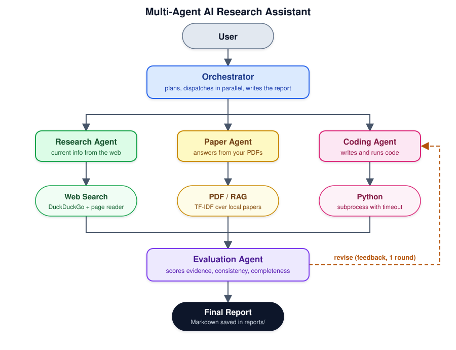

# Multi-Agent AI Research Assistant



## Setup

```bash
python -m venv .venv && source .venv/bin/activate   # Windows: .venv\Scripts\activate
pip install -r requirements.txt
cp .env.example .env                                  # then edit it
```

**LLM options** (set in `.env`):

| Option | Settings |
|---|---|
| Anthropic | `LLM_PROVIDER=anthropic`, `ANTHROPIC_API_KEY=...`, `LLM_MODEL=claude-sonnet-5-5` |
| Local, free (Ollama) | `LLM_PROVIDER=openai`, `OPENAI_BASE_URL=http://localhost:11434/v1`, `LLM_MODEL=llama3.1` |
| OpenAI or compatible | `LLM_PROVIDER=openai`, `OPENAI_API_KEY=...`, `LLM_MODEL=...` |

Small local models follow the agent format less reliably than large hosted ones, so expect weaker results.

## Usage

```bash
# put PDF papers in ./papers first (optional; the Paper Agent only appears if PDFs exist)
python main.py "Compare YOLO11 and RT-DETR for small-object detection on drone images" -v
python main.py "Summarise my papers on attention" --no-code
```

Options: `--papers DIR`, `--no-code`, `--rounds N` (evaluator revision rounds), `--provider`, `--model`, `-v`.

## How it works

1. **Orchestrator** asks the LLM for a JSON plan: which agents get which sub-task.
2. **Worker agents** run in parallel. Each is a ReAct loop (Thought / Action / Observation) over its own tools:
   - Research Agent: `web_search` (DuckDuckGo, no key), `read_url`
   - Paper Agent: `search_papers`, `list_papers` (TF-IDF retrieval over your PDFs)
   - Coding Agent: `run_python` (subprocess with timeout)
3. **Evaluation Agent** scores relevance, evidence, consistency and completeness. If it says "revise", the named agents rerun once with its feedback.
4. **Report writer** (inside the orchestrator) produces the final Markdown report from the agent outputs only.

## Tests

```bash
python -m tests.test_pipeline
```

These use a scripted fake LLM, so they need no API key or internet. They check the agent loop, the Python runner, PDF retrieval and the full pipeline wiring. They do not test real LLM quality or live web search.

## Safety notes

- `run_python` executes model-written code on your machine. It has a timeout and strips API keys from the environment, but it is **not a sandbox**. Run inside Docker for anything serious.
- Web pages can contain text that tries to steer the model (prompt injection). Treat reports as drafts and verify the cited sources.

## Ideas to extend

- Replace TF-IDF with embeddings (sentence-transformers + FAISS or Chroma).
- Add an arXiv / Semantic Scholar tool so the Paper Agent can download papers itself.
- Stream progress to a web UI (Streamlit or Gradio).
- Evaluate with a small benchmark of questions and track the evaluator scores over time.

## Layout

```
main.py                    CLI
assistant/
  llm.py                   Anthropic / OpenAI-compatible wrapper
  base_agent.py            ReAct loop
  agents.py                Research, Paper, Coding agents
  evaluation_agent.py      critique and scoring
  orchestrator.py          plan, dispatch, revise, report
  app.py                   wiring
  tools/                   web_search.py, pdf_rag.py, python_runner.py
tests/test_pipeline.py     offline tests
```
